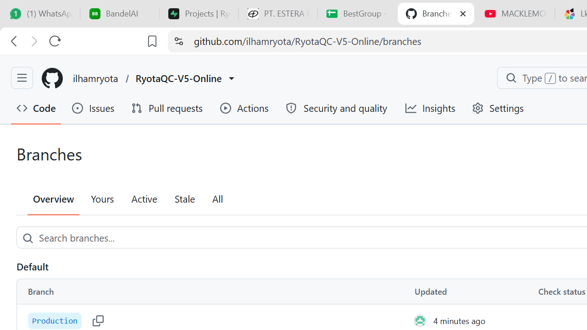

# RyotaQC V5 Online

<div align="center">



**Aplikasi Quality Control (QC) untuk teknisi perbaikan & refurbish laptop Windows.**

Dibangun dengan C# + WPF + MVVM · .NET 10 · Auto-update dari GitHub Releases

</div>

---

## Tentang Project

**RyotaQC V5 Online** adalah aplikasi desktop Windows yang membantu teknisi QC melakukan checklist pengujian laptop secara terstruktur, lengkap dengan report PDF, sinkronisasi ke ERP, dan auto-update otomatis.

## Cara Install (untuk teknisi / user)

> **Jangan** menjalankan `RyotaQC.App.exe` langsung dari folder repo/backup — itu
> bukan cara install, dan bisa memunculkan error *"This app can't run on your PC"*.

1. Buka halaman **Releases**: https://github.com/ilhamryota/RyotaQC-V5-Online/releases/latest
2. Unduh **`RyotaQC-V5-Setup-x64-v5.0.7.exe`** dan **`SHA256SUMS.txt`**
3. Verifikasi unduhan (wajib — unduhan terpotong adalah penyebab umum error "can't run"):
   ```powershell
   Get-FileHash .\RyotaQC-V5-Setup-x64-v5.0.7.exe -Algorithm SHA256
   ```
   Cocokkan hasilnya dengan baris di `SHA256SUMS.txt`.
4. Tutup aplikasi RyotaQC bila sedang berjalan
5. Klik kanan installer → **Run as administrator** → tunggu sampai selesai
6. Buka aplikasi dan pastikan nomor versi di menu utama sudah **v5.0.7**

> User yang masih di v5.0.2 / v5.0.3 / v5.0.4 / v5.0.5 **wajib** update manual
> sekali (langkah di atas) — auto-update dari versi-versi itu tidak akan berhasil,
> karena installer-nya berisi aplikasi versi lama. Detail: `docs\UPDATE_AND_INTEGRATION_GUIDE.md`
>
> User yang **sudah di v5.0.6 atau v5.0.7** tidak perlu langkah di atas lagi —
> cukup buka aplikasi, klik **"Update Sekarang"**, setujui UAC, lalu tunggu
> aplikasi terbuka kembali sendiri dalam versi terbaru.

## 4 Menu Utama

| # | Menu | Fungsi |
|---|------|--------|
| 1 | **System Information** | Informasi hardware real dari WMI: CPU, OS, RAM, Storage, GPU, serial number |
| 2 | **Wallpaper Desktop** | Set wallpaper desktop standar RyotaQC dengan 1 klik |
| 3 | **Software Licensing** | Buka MAS activation script sebagai administrator |
| 4 | **Quality Control** | Checklist 14 test laptop + sinkronisasi hasil ke ERP database |

## Quality Control — 14 Test

LCD Test, Storage Health, Battery Health, Battery Report, Keyboard Test, Audio Test, Benchmark, Camera, Touchscreen Test, Port Test, Touchpad, WiFi, Backlight, Mic.

Setiap test punya popup hasil: **OK** (Pass) / **-** (Skip) / **X** (Fail + catatan).

Hasil QC bisa:
- Disimpan sebagai **PDF** (QuestPDF)
- Disimpan sebagai **Notepad**
- **Sync ke ERP Hub** (`http://109.123.239.163:8005`) untuk update database pusat

## Fitur Auto-Update (Wajib)

Aplikasi **otomatis cek update** 5 detik setelah dibuka. Jika ada versi baru:
- Popup **"Update Wajib"** muncul
- User **tidak bisa menutup** popup sampai update selesai
- User klik "Update Sekarang" → download → restart otomatis

**Versi user tidak bisa dipakai sampai update versi terbaru diinstal.**

## Tech Stack

| Komponen | Teknologi |
|----------|-----------|
| Bahasa | C# 13 (.NET 10) |
| UI | WPF + MVVM |
| MVVM Toolkit | CommunityToolkit.Mvvm 8.4.2 |
| DI | Microsoft.Extensions.DependencyInjection 9.0.8 |
| PDF | QuestPDF 2025.7.4 |
| System Info | System.Management (WMI) |
| Target | Windows 10/11 x64 |

## Branch Strategy

| Branch | Isi | Untuk Siapa |
|--------|-----|-------------|
| **`Development`** | Source code project | Developer |
| **`Production`** | EXE self-contained siap pakai | User / teknisi |

## Cara Build Rilis (pipeline resmi)

Selalu pakai pipeline di bawah — **jangan** compile installer langsung dari
folder `publish\` buatan tangan:

```powershell
# 1. Publish aplikasi + staging payload ke release\staging\RyotaQC-V5
powershell -File scripts\01-publish-release.ps1 -Version 5.0.7

# 2. Compile Setup EXE (script ini MENOLAK jalan kalau versi payload != versi rilis)
powershell -File scripts\02-build-setup.ps1 -Version 5.0.7 `
  -InnoCompilerPath "$env:LOCALAPPDATA\Programs\Inno Setup 6\ISCC.exe"

# 3. ZIP update (isi di root, tanpa wrapper folder) + SHA256SUMS.txt
powershell -File scripts\04-build-update-zip.ps1 -Version 5.0.7
```

Hasil ada di `release\`:
- `RyotaQC-V5-Setup-x64-v5.0.7.exe` — installer
- `RyotaQC-V5-Update-v5.0.7.zip` — paket auto-update
- `SHA256SUMS.txt` — checksum, di-upload juga ke release

**Penting:** semua `#define` di `installer\RyotaQC.Setup.iss` dibungkus
`#ifndef`. Tanpa itu, nilai `/D...` dari command line **diabaikan** oleh Inno
Setup dan installer bisa berisi aplikasi versi lama — inilah bug yang membuat
rilis v5.0.3 / v5.0.4 / v5.0.5 tidak pernah benar-benar meng-update aplikasi.

## Versi

- Versi saat ini: **5.0.7**
- Setiap update naik 1 angka di belakang: 5.0.2 → 5.0.3 → 5.0.4 ...
- Versi ditampilkan di menu utama aplikasi.

## Lisensi & Credits

- **Author:** IllhamRyota
- **Copyright:** © RyotaQC V5
- Repo: https://github.com/ilhamryota/RyotaQC-V5-Online

---

<div align="center">

**RYOTAQC V5 ONLINE**

Dibuat oleh **IllhamRyota**

</div>